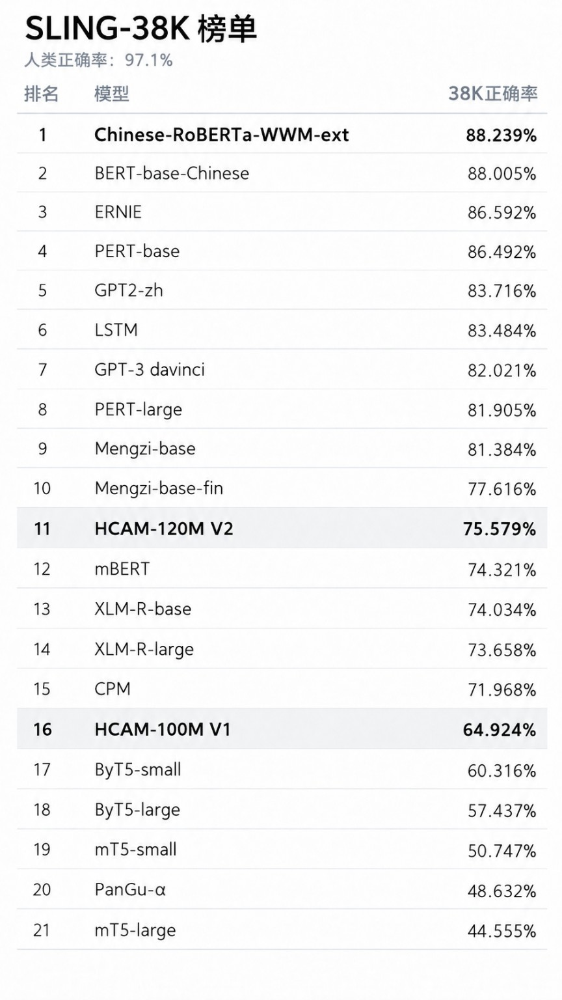

# HCAM 中文掩码语言模型 / HCAM Chinese Masked Language Models

**HCAM = Hybrid Convolution-Attention Model（混合卷积-注意力模型）**

这个仓库现在作为 **HCAM 中文 MLM 系列**的项目主页。

- **HCAM V1 / 100M**：约 **102.78M** 参数，已经开源代码、FP32 权重、训练方法与评测。
- **HCAM V2 / 121M**：约 **121.08M** 参数，完成第二代预训练与外部基准评测；**目前仅公开技术报告与结果，不公开权重和完整训练代码**。

> V1 仍然是本仓库当前可下载、可复现、可直接运行的公开模型，也是本仓库原始技术报告 [`REPORT_HCAM.md`](REPORT_HCAM.md) 的主体。  
> V2 是建立在 V1 已验证架构与训练经验之上的第二代迭代版本；整体语言能力进一步提高，同时在字符级恢复与局部搭配任务上继续表现出 HCAM 的优势倾向，并单独记录在 [`REPORT_HCAM_V2.md`](REPORT_HCAM_V2.md) 中。V2 当前只公开技术报告与结果。

## 版本概览 / Versions

| 项目 | HCAM V1 | HCAM V2 |
|---|---:|---:|
| Parameters | 102.78M | **121.08M** |
| Layers | 10 | **11** |
| Local / Global | 7 Local + 3 GQA | **8 Local + 3 GQA** |
| Hidden size | 1056 | **1088** |
| Attention layers | 3 / 7 / 10 | **3 / 7 / 11** |
| Query / KV heads | 16 / 4 | **16 / 4** |
| Vocabulary | 18K character vocab | **23K mixed vocab** |
| Chinese tokenization | character | **one Chinese character = one token** |
| Latin | character-heavy | **≤2.8K Latin BPE, selective case retention** |
| Context | 600 | **624** |
| Dropout | 0.10 | **0.05** |
| Main objective | multi-granularity MLM | **dynamic multi-granularity MLM + light Self-Critic RTD** |
| Prepared train tokens | ~1.638B chars | **3.5B tokens** |
| Total passes | 2 | **3.4** |
| SLING-38K | 64.924% | **75.579%** |
| Reflexive-560 | **67.857%** | 66.071% |
| Release status | **code + weights** | **report only** |

文档定位：

- **[`REPORT_HCAM.md`](REPORT_HCAM.md)** — 原始完整技术报告，主体对应 **HCAM V1 / 100M**；
- **[`REPORT_HCAM_V2.md`](REPORT_HCAM_V2.md)** — 第二代补充技术报告，记录 **HCAM V2 / 121M** 的结构、训练摘要与最终结果。

---

## HCAM V2：第二代结果摘要 / V2 summary

HCAM V2 延续“多数局部层 + 少数全局注意力层”的基本方向，但扩大到 **121.08M** 参数，并加入动态局部卷积、headwise attention gate、rank-16 H-gate、23K 中英混合词表、3.5B 数据、3.4 遍训练课程以及轻量 Self-Critic RTD。

最终第 34 个 virtual epoch：

| Evaluation | Result |
|---|---:|
| Fixed validation MLM loss | **1.3717** |
| Fixed validation Top-1 | **70.14%** |
| Hard 25% masking Top-1 | **60.90%** |
| Hard 25% masking Top-5 | **77.50%** |
| Character-mask Top-1 | **78.38%** |
| Whole-piece Top-1 | **63.92%** |
| Multi-span Top-1 | **50.56%** |
| RTD balanced accuracy | **83.96%** |
| Final RTD weight | **0.12** |

外部语言学评测：

| Benchmark | V1 | V2 | Δ |
|---|---:|---:|---:|
| SLING-38K | 64.924% | **75.579%** | **+10.655 pp** |
| Reflexive-560 | **67.857%** | 66.071% | -1.786 pp |

SLING-38K 中，V2 正确 **28,720 / 38,000**，比 V1 多答对 **4,049** 对。 这说明 V2 在 V1 已经可用的基础上取得了明显的整体能力提升；不过提升并非所有子基准都完全一致。V2 的提升并不完全均匀：WhFronting、DefinitenessEffect、Classifier-Noun 等现象很强，而 RelativeClause 仍然是明显短板。Reflexive-560 中，V2 的 Natural 子集高于 Auto 子集，显示第二代在自然句上的表现提升并没有同步转化为所有人工句法模板上的优势。



> SLING-38K 参考对照图：用于直观展示 HCAM V1 / V2 在同一 38K 评测口径中的分数位置。


### V2 下游字符纠错与量化 / Character correction & quantization

在预训练完成后，V2 又从基座重新微调了一个联合字符纠错模型，目标为 **的 / 地 / 得 / 做 / 作**。该任务仍采用字符级 masked prediction：待判断位置被遮蔽，模型直接根据双向上下文预测正确字符。

在微调前，V2 基座在 500 句、1,082 个目标位置的五字测试上已经达到 **88.262% Accuracy / 85.841% Macro-F1**。微调后的最终 FP32 模型在内部验证口径上达到：

| Model / strategy | Accuracy | Macro-F1 | Macro-F0.5 |
|---|---:|---:|---:|
| V2 base, all-mask | 88.262% | 85.841% | 86.373% |
| V2 fine-tuned FP32, all | **98.969%** | **96.730%** | **97.035%** |
| V2 fine-tuned FP32, single | **99.062%** | **96.791%** | — |

在另一组 FreshNatural“的 / 地 / 得”自然文本测试（4,980 个目标位置）中，V2 微调模型达到 **99.438% Accuracy / 99.470% Macro-F1**，高于旧版 HCAM 模型的 **99.096% / 99.199%**。

移动端部署最终采用 **ExecuTorch `.pte` + XNNPACK Dynamic INT8 per-channel**。量化模型约 **117.24 MiB**；对应 FP32 导出约 **462.66 MiB**，体积缩小约 **3.95×**。在 2,000 句 / 6,501 个目标位置的完整 PTE Runtime 等价性验证中：

- Accuracy：**99.000%**
- Macro-F1：**96.823%**
- Macro-F0.5：**97.168%**

没有观察到可测的量化精度损失。另有约 **116.97 MiB** 的 ONNX Runtime dynamic INT8 版本，供 Windows / CPU 部署使用。

这些下游结果也说明，**SLING 总分并不能代表 HCAM 在所有任务上的相对位置**。HCAM 从设计上保持中文字符级 tokenization，并让多数层承担局部建模；在字符恢复、局部搭配、近邻语法和字形级纠错这类任务上，它可能比综合语言学榜单所显示的排名更有竞争力。V1 已经在“的 / 地 / 得”任务上表现出这一特征，V2 又在自然字符纠错测试上进一步超过 V1。

V2 暂不提供权重与完整训练代码；本仓库现有 `hcam.py`、`train_pretrain.py`、Release 权重仍对应 V1。

---

# HCAM V1 / 100M — Open-source release

HCAM V1 是一个约 **102.78M 参数**的中文双向掩码语言模型。它使用 **7 个双向门控扩张卷积层 + 3 个双向 Gated-GQA 全局注意力层**，以字符级 18K 词表建模中文文本，并通过 SentencePiece 边界指导多粒度 MLM 掩码。

> 本仓库可下载的模型权重和可运行训练/推理代码均为 V1。  
> Dededi“的/地/得”微调仅作为一个小型下游实验。

## 项目缘起 / Motivation

HCAM 最初并不是为了超越某个现有模型而训练的。这个项目来自对语言模型架构、从零训练流程，以及卷积与注意力混合结构的长期兴趣。在 V1 之前，同一条架构思路已经分别在 **16M、30M、55M 和 100M** 规模的自回归语言模型上进行过实验。

在这些自回归实验之后，项目进一步转向双向掩码语言建模，并重新设计了预训练目标、动态多粒度掩码策略、字符级 tokenizer 与训练流程，最终得到 HCAM V1。V1 后续在中文“的 / 地 / 得”纠错任务上的微调结果推动了模型压缩、量化和 Android 端部署。

V2 则是在 V1 之后继续扩大数据、训练预算与训练目标设计的第二代实验版本。

## V1 核心规格 / V1 key specifications

| 项目 / Item | 配置 / Value |
|---|---:|
| Parameters | **102,778,220** |
| Vocabulary | 18,000 character tokens |
| Context length | 600 |
| Hidden size | 1056 |
| Layers | 10 |
| Local gated dilated-conv layers | 7 |
| Global Gated-GQA layers | 3 (layers 3 / 7 / 10) |
| Query / KV heads | 16 / 4 |
| Head dim | 66 |
| Local inner dim | 1600 |
| GQA FFN dim | 2944 |
| Norm / FFN / Position | RMSNorm / SwiGLU / RoPE |
| Dropout | 0.10 |
| Weight tying | Input embedding = LM head |

```text
Token Embedding + learned Mask Embedding
          │
          ▼
  1  Gated Dilated Conv   k=3 d=1
  2  Gated Dilated Conv   k=3 d=2
  3  Gated GQA
  4  Gated Dilated Conv   k=5 d=2
  5  Gated Dilated Conv   k=3 d=1
  6  Gated Dilated Conv   k=3 d=2
  7  Gated GQA
  8  Gated Dilated Conv   k=5 d=2
  9  Gated Dilated Conv   k=3 d=1
 10  Gated GQA
          │
       RMSNorm
          │
 Tied 18K Character LM Head
```

## V1 预训练 / V1 pretraining

- 有效不重复训练语料：约 **1.638B 字符**
- 训练调度：10 个 virtual epochs，合计两遍完整语料
- 总训练暴露量：约 **3.276B character-token exposures**
- 固定验证集：1M character tokens
- 有效全局 batch：384
- Peak LR：`7e-4`
- Weight decay：`0.08`
- 总遮蔽率：30% → 15%
- 被选位置替换：80% learned mask embedding / 10% random char / 10% unchanged

训练数据目标比例：

- Ultra-FineWeb Chinese: ≤50%
- SkyPile-150B Chinese: 32%
- Wikipedia: 14%
- Custom/user corpus: 4%

详细来源与许可风险见 [`DATA_LICENSES.md`](DATA_LICENSES.md)。

## V1 预训练结果 / V1 pretraining results

| Evaluation | MLM Loss | Masked PPL | Top-1 | Top-5 |
|---|---:|---:|---:|---:|
| Final fixed validation | **1.9900** | **7.32** | **60.76%** | — |
| Standard mixed masking benchmark | 2.0044 | 7.42 | 60.58% | 75.50% |
| Whole-piece/span stress benchmark | 3.0540 | 21.20 | 43.87% | 59.49% |

这里的 PPL 是 `exp(masked cross-entropy)`，不能直接与不同 tokenizer / 不同 MLM 定义的模型横向比较。

## 真实文本与长距离依赖基准 / Real-text & long-range benchmark

| Model | Params | REAL-MLM Top-1 | REAL-MLM Top-5 | Rare char Top-1 | Rare whole-span |
|---|---:|---:|---:|---:|---:|
| **HCAM-100M** | 102.78M | **68.50%** | **88.38%** | 9.79% | 1.33% |
| Chinese-RoBERTa-WWM-ext | 102.29M | 74.00% | 88.50% | 19.71% | 4.33% |
| RoFormerV2-Char-Base | 94.18M | 38.38% | 61.00% | 17.02% | 4.67% |

REAL-LONG 四个距离桶（64–469 字）简单平均：

| Model | Full Top-1 | No-cue Top-1 | Whole-span | Cue help rate | Mean ΔlogP |
|---|---:|---:|---:|---:|---:|
| **HCAM-100M** | 46.54% | 13.32% | 32.50% | **95.00%** | **+2.467** |
| Chinese-RoBERTa-WWM-ext | 58.54% | 22.87% | 45.63% | 96.25% | +2.296 |
| RoFormerV2-Char-Base | 60.09% | 20.55% | 45.00% | 95.63% | +2.574 |

在最远的 **384–469 字**距离桶中，删除远端 Cue 会使 HCAM V1 Top-1 从 **42.45%** 降到 **10.38%**，平均 `ΔlogP=+2.441`。这表明三层全局 Gated-GQA 已经能够让数百字之外的信息稳定影响目标位置。

完整测试定义、基线健康检查与各距离桶结果见 [`REAL_BENCHMARK.md`](REAL_BENCHMARK.md)。

## 小型下游实验：的 / 地 / 得

第一版 HCAM E3-EMA 微调把每一个待判断的“的/地/得”位置替换为预训练 learned mask embedding，再基于双向上下文恢复类别。

| Evaluation | HCAM E3-EMA | RoFormerV2 E3-EMA |
|---|---:|---:|
| Mixed Total, 720 sentences / 2,275 targets — Macro-F1 | **98.17%** | 95.85% |
| External DEV, 1,600 sentences / 3,025 targets — Macro-F1 | **97.496%** | 95.806% |
| Natural DEV3, 1,200 snippets / 2,734 targets — Macro-F1 | **95.148%** | 83.205% |
| Natural DEV3 — Macro-F0.5 | **95.882%** | 84.774% |
| Natural DEV3 — clean false-action rate | **0.988%** | 3.548% |

这些结果只代表该纠错任务。Natural DEV3 来自 DRCD-dev 与 Wikipedia 各 600 条，目标分布为 的 2268 / 地 333 / 得 133。

## 实际应用示例 / Real-world application demo

HCAM V1 的预训练基座已经被进一步微调用于中文“的 / 地 / 得”纠错，并集成到作者的 Android 应用中。


截图中的 Android 端运行的是量化后的 ExecuTorch/XNNPACK 部署版本，而不是 FP32 预训练基座。

更多 V1 细节见 [`REPORT_HCAM.md`](REPORT_HCAM.md)。

## 下载 V1 权重 / Download V1 weights

正式 FP32 基座约 **392 MiB**，请从仓库 **Releases** 下载：

- `hcam_100m_base_fp32.pt`
- `tokenizer.model`

## 快速使用 / Quick start

```bash
pip install -r requirements.txt
```

```python
import torch
from hcam import HCAMTokenizer, load_hcam, masked_logits

tok = HCAMTokenizer("tokenizer.model")
model, meta, _ = load_hcam(
    "hcam_100m_base_fp32.pt",
    device="cuda" if torch.cuda.is_available() else "cpu",
)

text = "温室里的植物正在安静地生长。"
ids = torch.tensor([tok.encode(text)], device=next(model.parameters()).device)
positions = torch.tensor([[4]], device=ids.device)
logits = masked_logits(model, ids, positions)
print(tok.pieces[int(logits[0, 0].argmax())])
```

也可以运行：

```bash
python benchmark.py --model hcam_100m_base_fp32.pt --tokenizer tokenizer.model
```

## 仓库文件 / Repository files

- `README.md` — 项目首页与版本概览
- `REPORT_HCAM.md` — V1 技术报告
- `REPORT_HCAM_V2.md` — V2 技术报告、训练摘要与最终评测
- `sling_38k_leaderboard.png` — SLING-38K 分数对照图
- `REAL_BENCHMARK.md` — V1 真实文本 MLM、稀有跨度与长距离依赖对比
- `hcam.py` — V1 架构、tokenizer、加载函数
- `train_pretrain.py` — V1 预训练代码
- `benchmark.py` — V1 最小 MLM 测试
- `requirements.txt` — Python dependencies
- `LICENSE` — 代码 Apache-2.0
- `MODEL_LICENSE.md` — 已发布 V1 模型权重许可
- `DATA_LICENSES.md` — V1 数据来源与上游许可说明

## 许可与版本状态 / License & release status

- **V1 code:** Apache License 2.0 + `NOTICE`
- **V1 model weights:** CC BY 4.0, attribution required, to the extent of rights the author can grant
- **V1 training data:** governed by their own upstream terms; see `DATA_LICENSES.md`
- **V2:** 当前仅公开技术报告与评测结果；未发布权重和完整训练代码

建议署名：

> **HCAM by qilimary**

## 已知限制 / Known limitations

- HCAM 是双向 MLM 编码器，不是自回归聊天模型。
- V1 上下文长度为 600；V2 为 624。
- V1 与 V2 都只有 3 层全局注意力，复杂的多阶段全局推理仍值得进一步评测。
- V2 的多字符同时恢复能力仍明显弱于单字符恢复。
- 不同 tokenizer、mask 课程和训练数据下的 MLM loss / PPL 不应直接横向比较。
- V2 当前不是公开模型发布，只是项目的第二代实验与技术报告。

## Author

`qilimary` — 2026
